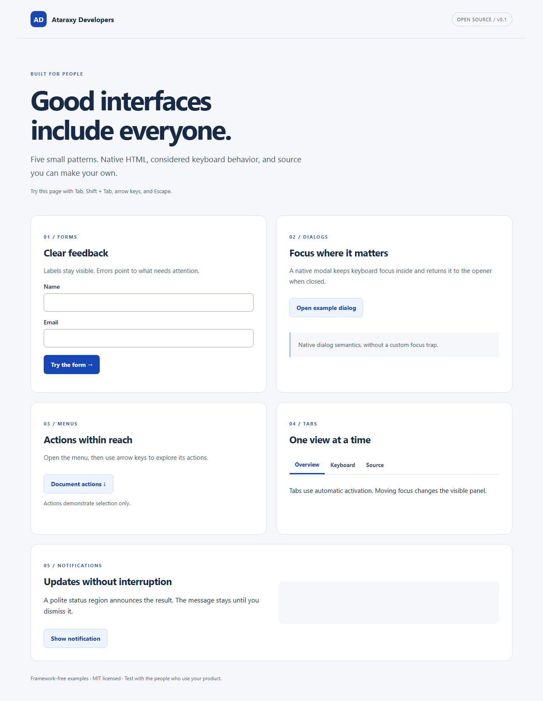

# Accessible UI Recipes

[](https://github.com/AtaraxyDevelopers/accessible-ui-recipes/actions/workflows/ci.yml)
[](LICENSE)

Five framework-free UI patterns with keyboard and automated accessibility tests.

An open-source project from [Ataraxy Developers](https://github.com/AtaraxyDevelopers).



## Quick start

Requires Node.js 22 or 24 and npm. Git is optional if you download the source ZIP.

```sh
git clone https://github.com/AtaraxyDevelopers/accessible-ui-recipes.git
cd accessible-ui-recipes
npm ci
npm test
```

```sh
npm start
```

Open **http://127.0.0.1:4330**. The examples use plain HTML, CSS, and JavaScript,
with no runtime dependencies. Copy the markup and the relevant initialization block
from `public/app.js` into your application, retaining labels and unique IDs.

## Patterns

| Pattern      | Keyboard and semantics                                             |
| ------------ | ------------------------------------------------------------------ |
| Form         | Persistent labels, linked errors, first-error focus, polite result |
| Dialog       | Native modal dialog, Escape to close, focus returned to opener     |
| Action menu  | Arrow keys, Home/End, Enter, Escape, and Tab dismissal             |
| Tabs         | Automatic activation, Left/Right, Home/End, roving tabindex        |
| Notification | Persistent polite live region, explicit dismissal, no timeout      |

## Browser verification

```sh
npm run browser:install
npm run test:browser
```

The browser suite uses Chromium, Playwright, and axe-core. CI runs it on Linux and
also runs the HTTP server test on Windows, macOS, and Linux with Node 22 and 24.
Automated tests cover keyboard actions, focus restoration, visible panels, form
errors, notifications, and a 390-pixel mobile viewport.

## Manual review checklist

- Traverse all controls with Tab and Shift+Tab; focus must stay visible.
- Open the dialog and verify background controls cannot receive focus.
- With a screen reader, confirm labels, errors, tab selection, and status updates.
- Zoom to 200% and 400%; check that content remains readable and controls reachable.
- Repeat with your target browsers, assistive technologies, and real content.

## Scope and limitations

Passing axe checks is not accessibility certification. These examples have automated
Chromium coverage; screen-reader usability and other browsers require manual review.
The email check is a demonstration, not authoritative address validation. Menu actions
only demonstrate selection. The form and notification send and store no information.
The notification's save wording is simulated. The server binds to local IPv4 only.

References: [WAI-ARIA tabs](https://www.w3.org/WAI/ARIA/apg/patterns/tabs/),
[menu button](https://www.w3.org/WAI/ARIA/apg/patterns/menu-button/),
and [Playwright accessibility testing](https://playwright.dev/docs/accessibility-testing).

## Contributing and support

See [CONTRIBUTING.md](CONTRIBUTING.md), [community expectations](CODE_OF_CONDUCT.md),
and [SECURITY.md](SECURITY.md). Open an issue with a minimal synthetic reproduction.
This project is maintained on a best-effort basis. No paid service or account is
required to run the local examples.

## License

[MIT](LICENSE). You may use, adapt, and redistribute this project under its license.
